# Entrega — Estação Cofre (Segurança, Autenticação e Criptografia)

**Aluno:** José Arcangelo
**Turma:** AMF 2026-02
**Prefixo MQTT (`NOME`):** `sis1a/jose/`
**Link do Worker:** `https://estacao-cofre.josearcangelogarlet.workers.dev`
**Ambiente do ESP32:** Wokwi (ESP32 + DHT22, Wi-Fi `Wokwi-GUEST`)

---

## Evidências (prints)

### Passo 1 — Antes de trancar
Não tenho estes prints. Quando comecei a atividade, o Worker novo (com `autenticar()`) já estava no ar,
então o ataque `Falso` não chegou a gravar o 999. O contraste "antes × depois" da camada 2 está no Passo 3
(sem chave → 401) e no Passo 5 (com a API key vazada, o atacante ainda grava dado falso).

### Passo 3 — Camada 2 (API key)
`ataques.ps1 -Teste Todos` com `-ApiKey`: `Falso` e `Sem API key` → **401**,
`Com API key` → **200**, e as tentativas recusadas registradas no Worker:

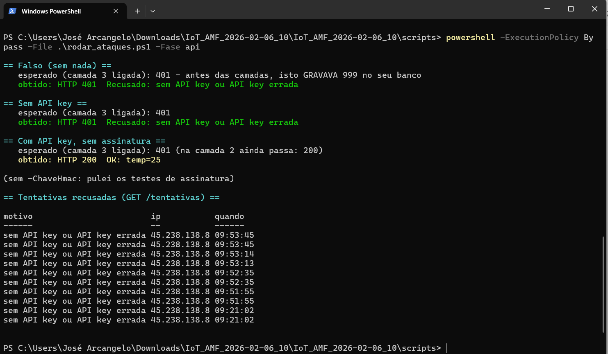

### Passo 4 — Camada 1 (TLS)
Serial Monitor (Wokwi): NTP ok, MQTT por TLS ok e HTTPS com **200**. O MQTT usa a porta **8883** (veja
"O que vocês mudaram"):

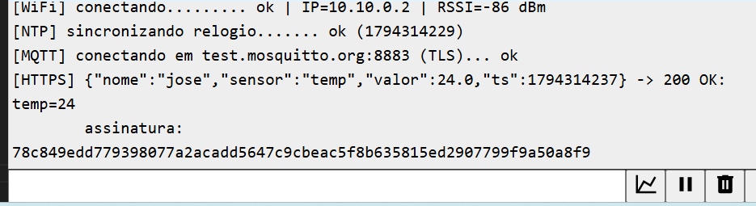

Prova da CA errada: troquei `tlsMqtt.setCACert(CA_MOSQUITTO)` por `CA_WORKER` e o MQTT falhou com
`X509 - Certificate verification failed` (`rc=-2`). Depois voltei para `CA_MOSQUITTO`:

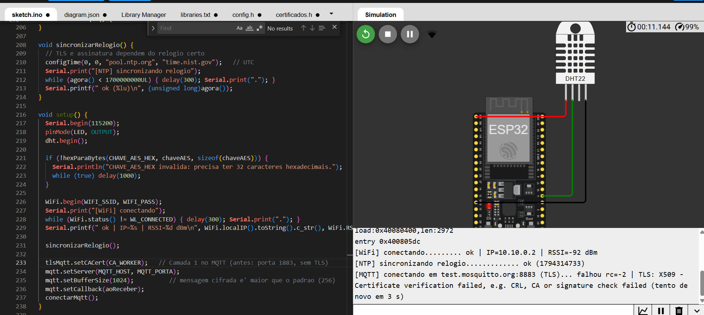

### Passos 5 e 6 — Camada 3 (HMAC + anti-replay)
**Antes** (`EXIGIR_ASSINATURA = nao`): `Adulterado` (grava `temp=45`), `Replay` (as duas vezes) e `Atrasado`
passam todos com **200**:

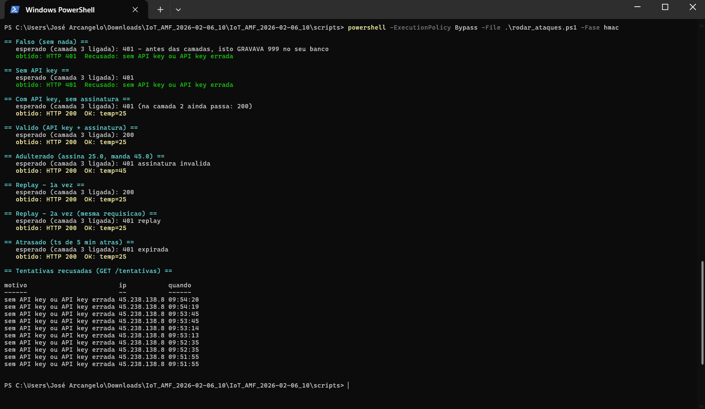

**Depois** (`EXIGIR_ASSINATURA = sim`): sem assinatura → 401, `Valido` → 200, `Adulterado` → 401,
`Replay` 200 → **401**, `Atrasado` → **401**. No fim, a lista de **tentativas recusadas** com o motivo de cada ataque:

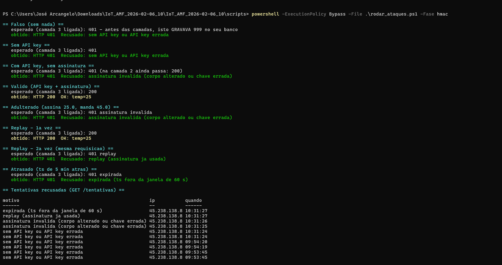

### Passo 7 — Camada 4 (cofre AES-GCM)
Tópico `sis1a/jose/cofre` aparecendo como **CIFRADO** (só ruído) na seção 1, ao lado de uma mensagem em claro
(`sis1a/jose/teste`, em vermelho, **LEGÍVEL**) que usei para comparar:

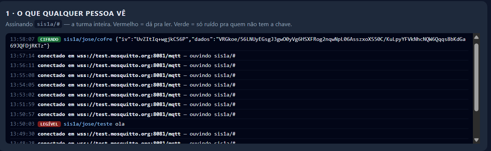

Valores **decifrados** com a chave certa (✔ aberto):

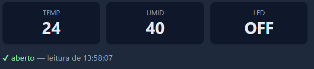

Sem a chave certa (campo da chave vazio) o cofre **não abre** (✘ não abriu):

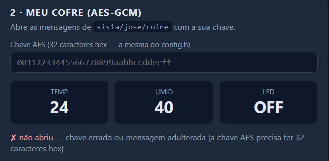

### Passo 8 — Comandos assinados
As respostas aparecem no Serial do ESP32 (linha `[CMD] ...`).

- `OK: led:ON` (comando assinado, o LED acende):

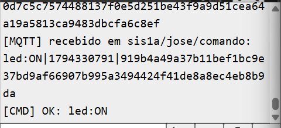

- `RECUSADO: sem assinatura` (comando `led:ON` sem assinar):

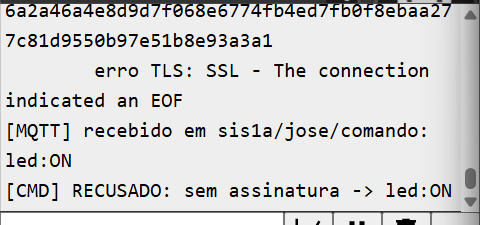

- `RECUSADO: replay (comando repetido)` (reenvio do mesmo comando assinado):

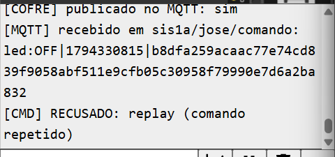

- `RECUSADO: assinatura invalida` (chave de colega): **não tenho este print.** Durante um dos testes, uma chave HMAC
  digitada errada na página produziu exatamente essa resposta (`[CMD] RECUSADO: assinatura invalida`),
  mas não guardei o print.

---

## O que vocês mudaram no código

- Gerei `API_KEY`, `CHAVE_HMAC` e `CHAVE_AES_HEX` aleatórias (32/64/32 caracteres) e preenchi o `config.h`.
- Criei o `.gitignore` com `config.h`, porque a pasta da atividade não trazia o arquivo e sem ele o `config.h` iria para o GitHub (buraco 5).
- **`estacao_cofre.ino` / `config.h`:** o broker `test.mosquitto.org` passou a recusar o login `rw/readwrite` na porta 8885 (`rc=5`, testado também fora do ESP32). Usei a porta **8883** (TLS, validando a CA do Mosquitto com `setCACert`) e conecto **sem usuário e senha**. A segurança do dado continua nas camadas TLS validado, HMAC e AES-GCM.
- **`estacao_cofre.ino`:** o HTTPS instável do simulador demorava e o broker derrubava o MQTT (o `publish` do cofre falhava em silêncio). Passei a publicar o cofre **antes** do HTTPS, chamar `mqtt.loop()` entre as chamadas, usar `setKeepAlive(60)` e imprimir `publicado no MQTT: sim/NAO`.
- **Ambiente:** testei o ESP32 no **Wokwi** (DHT22, Wi-Fi `Wokwi-GUEST`), com `NOME = jose`.

---

## Respostas

1. **Por que falhar é o comportamento correto? O que aconteceria com `setInsecure()`?**

   Porque o ESP32 não conseguiu confirmar quem estava do outro lado. Se fosse um atacante no meio do caminho, a conexão seria barrada. Com `setInsecure()` ela abriria do mesmo jeito e o atacante veria e mudaria tudo sem ninguém perceber.

2. **Por que a temperatura aparecia legível no Passo 1 e por que o AES-GCM resolve?**

   O TLS só protege o caminho até o broker, e o broker entrega a mensagem aberta para quem assina o tópico. Com o AES-GCM a mensagem já sai cifrada do ESP32, então o broker e os colegas só veem texto sem sentido. Só abre quem tem a chave.

3. **API key x HMAC: o que o atacante faz se capturar uma requisição de cada?**

   Com a API key ele passa a gravar o que quiser, porque a chave é o próprio segredo (foi o que aconteceu no Passo 5). Com a requisição assinada ele só consegue repetir a mesma, e o `ts` e a assinatura de uso único barram isso.

4. **O que daria errado se o `ts` ficasse fora do corpo assinado?**

   O atacante poderia reenviar uma requisição antiga trocando só o horário, e a assinatura continuaria valendo. Dentro do corpo, mexer no `ts` quebra a assinatura.

5. **Por que `request.text()` em vez de `request.json()`?**

   Porque a assinatura vale para os bytes exatos que o ESP32 mandou. Se o Worker remontasse o JSON, espaços ou formato de número (`24.0` e `24`) mudariam e a conta não fecharia.

6. **As rotas `/list` e `/resumo` abertas são um problema?**

   Aqui não, são só temperatura e umidade. Seria problema com dado sensível, como horário de uso de um atuador, localização ou saúde. Aí a leitura também precisaria de autenticação.

7. **Como resolver a chave AES colada à mão em mil dispositivos?**

   Cada aparelho sairia da fábrica com a sua chave, e a troca de chaves seria feita com criptografia assimétrica, sem a chave AES passar em claro. Assim, se uma vazar, as outras continuam seguras.

8. **Pior estrago no Projeto Final sem as camadas e qual camada levar?**

   Alguém ligar o atuador à distância e gravar leituras falsas. Vou levar o comando assinado com `ts`, junto com o TLS validado e o `config.h` fora do GitHub.

---
**Entrega:** este `ENTREGA.md` (com a pasta `prints/`), `estacao_cofre.ino`, `worker.js` e `certificados.h`, no
GitHub, **sem o `config.h`**.
